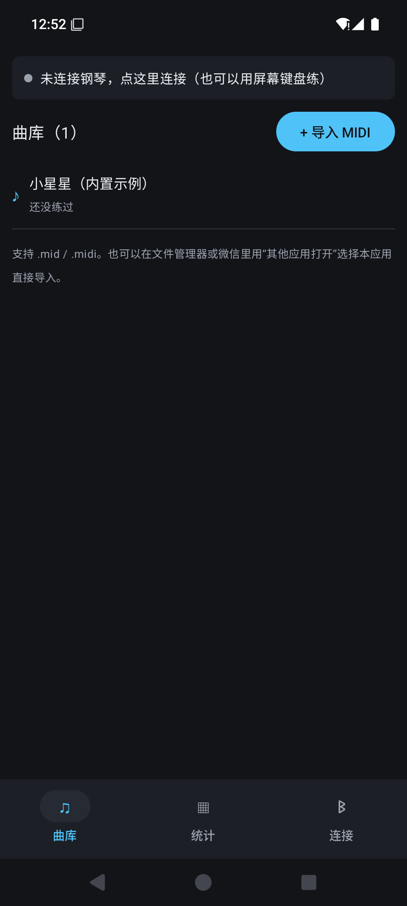
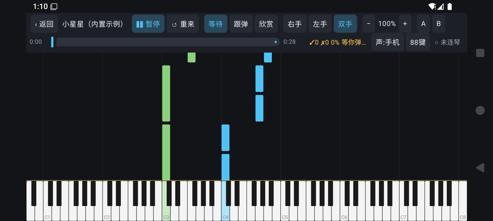
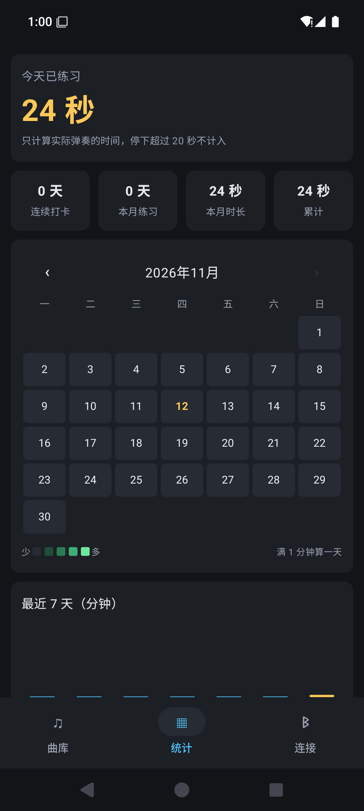
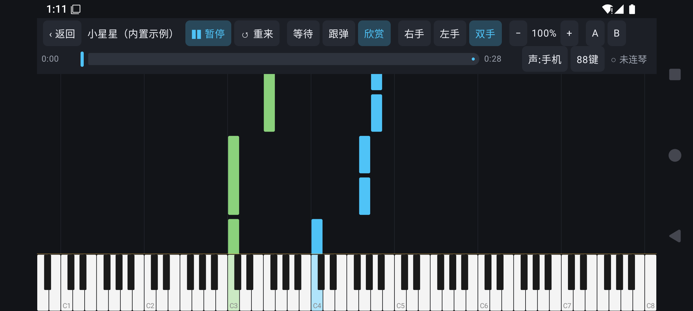
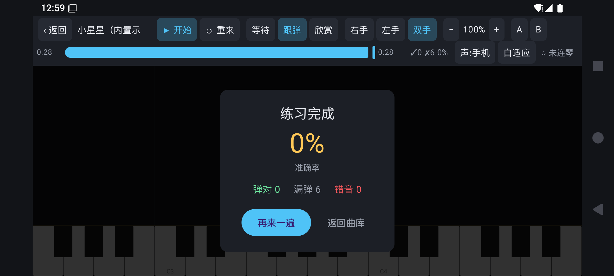
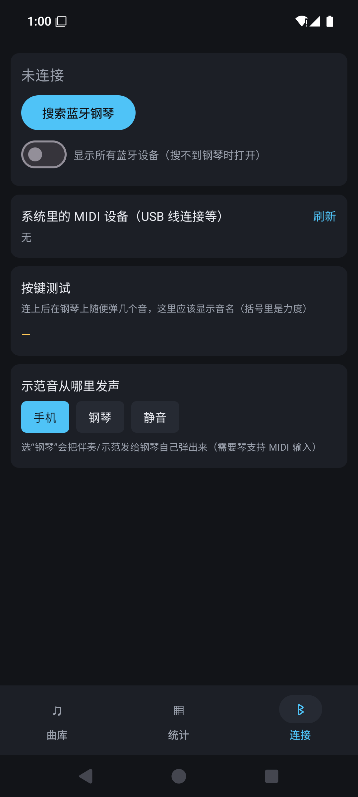
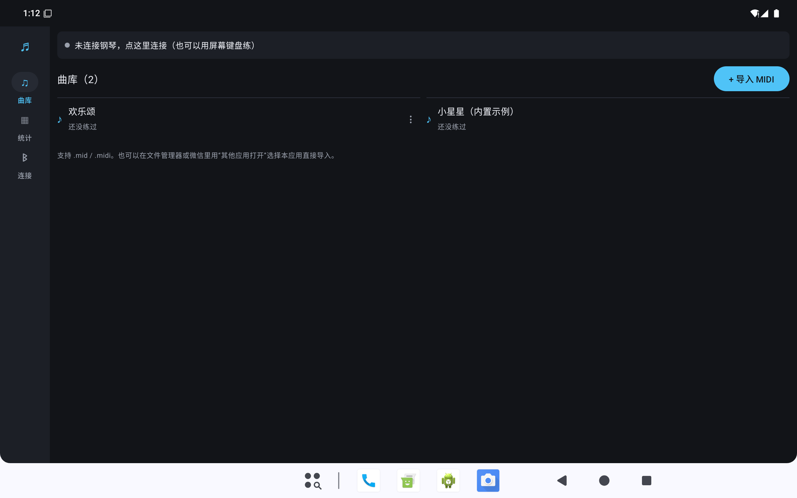
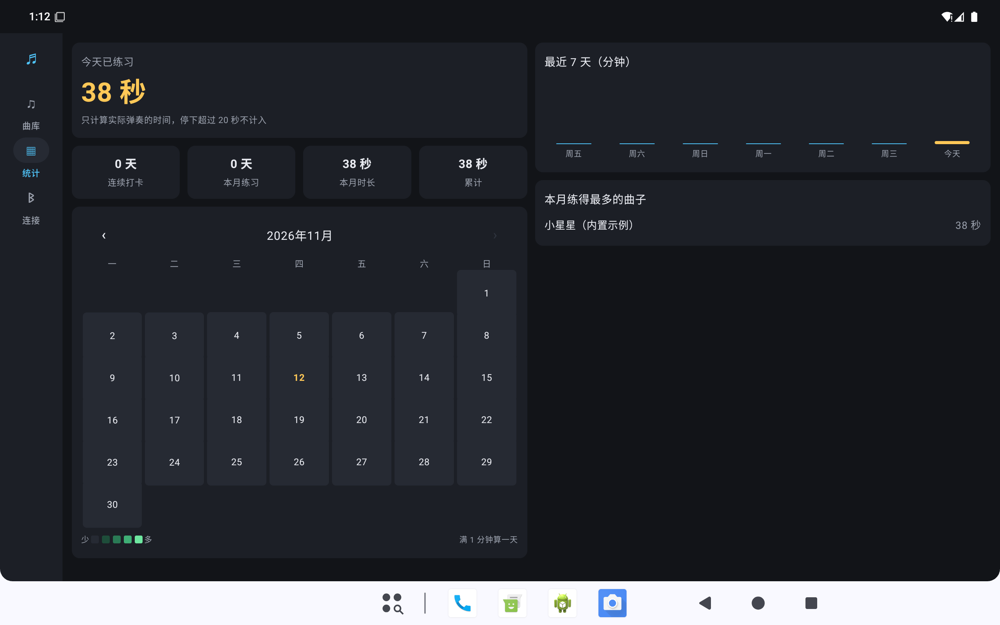
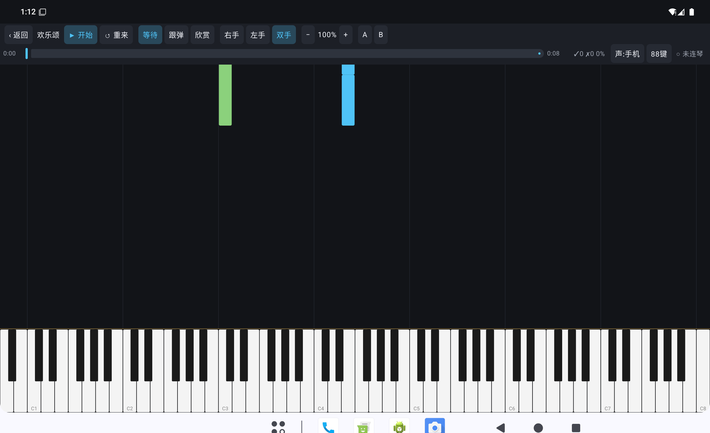

# 钢琴练习 Piano Practice

一个 Android 钢琴练习 App：88 键瀑布流下落谱 + 蓝牙 MIDI 电钢琴跟弹，支持导入自己的 MIDI 曲目，并记录每天的练习时长与正确率。

界面用 Jetpack Compose 编写，手机横屏练习，平板自动切换为侧栏导航和双列布局。

| 曲库 | 跟弹练习 | 练习统计 |
| --- | --- | --- |
|  |  |  |

| 欣赏模式 | 结算 | 蓝牙连接 |
| --- | --- | --- |
|  |  |  |

平板布局（自动适配宽度 ≥ 840dp）：

| 平板曲库 | 平板统计 | 平板练习 |
| --- | --- | --- |
|  |  |  |

## 功能

- **三种练习模式**
  - 等待：谱面停在要弹的和弦处，弹对才继续，适合初学
  - 跟弹：按时间轴播放，按键在判定窗口内即可得分，超时算漏音
  - 欣赏：自动演奏，用来熟悉曲子
- **左右手分开练**：只显示所选手的下落音符，另一只手自动伴奏；也可双手一起
- **88 键标准键盘**：A0–C8 完整音域，黑键按标准位置排布；可切换为「自适应」（只显示当前曲子用到的音域）
- **变速与循环**：20%–200% 速度，A/B 两点循环，进度条任意跳转
- **MIDI 曲目导入**：解析标准 MIDI 文件（支持 running status、速度变化），按音轨/通道/音高自动分配左右手
- **蓝牙 MIDI 电钢琴**：通过 BLE-MIDI 连接（实测贝多辰 B101），也支持系统里已有的 USB MIDI 设备
- **声音输出三选一**：手机内置合成器（AudioTrack）/ 发送给钢琴自己发声 / 静音
- **练习统计**：当日时长、连续打卡、月历热力图、最近 7 天柱状图、本月曲目时长；点日历中的日期可查看当天弹了哪些曲子及每首的正确率
- **横屏练习**、常亮屏幕、返回即暂停并保存

## 构建

环境要求：

- JDK 17
- Android SDK Platform 35、Build-Tools 35.0.0
- 最低运行 Android 8.0（API 26）

```bash
git clone https://github.com/chengximin84-cpu/Piano-practice.git
cd Piano-practice

# 指向本机 Android SDK
echo 'sdk.dir=/path/to/Android/Sdk' > local.properties

./gradlew assembleDebug
# 产物：app/build/outputs/apk/debug/app-debug.apk
```

> 项目放在中文路径下时，`gradle.properties` 里的 `android.overridePathCheck=true` 可以避免 AGP 的路径检查报错。

运行单元测试（MIDI 解析、判分逻辑、键盘几何）：

```bash
./gradlew testDebugUnitTest
```

## 使用

1. **连接钢琴**：打开电钢琴的蓝牙，进入「连接」页授予“附近设备”权限，点「搜索蓝牙钢琴」，选中设备后即可弹奏；用数据线连接的 MIDI 琴会直接出现在「系统里的 MIDI 设备」里。连接页的「按键测试」可以看到琴发来的音名和力度。
2. **导入曲目**：把 `.mid` 文件放进手机，用文件管理器的“打开方式”选择本应用；也可以在曲库页导入。
3. **开始练习**：点开曲子进入横屏练习页，选择模式（等待/跟弹/欣赏）、左右手和速度。等待模式下音符会停住，弹对当前和弦才继续。
4. **看统计**：练习时长只计算实际弹奏的时间，停顿超过 20 秒不计入；弹完或退出时记录本次正确率，可在统计页点日期查看。

## 项目结构

```
app/src/main/java/com/cxm/piano/
├── midi/      MIDI 文件解析、BLE-MIDI 与系统 MIDI 设备连接
├── practice/  键盘几何（KeyLayout）、播放与判分引擎、瀑布流界面
├── audio/     AudioTrack 合成器与输出切换
├── stats/     每日练习时长 / 正确率持久化（JSON）
├── ui/        曲库、统计、连接页（Compose）
└── MainActivity.kt / PianoApp.kt
```

技术栈：Kotlin 2.0 + Jetpack Compose（Material 3），`android.media.midi`，纯本地存储，无网络权限、无第三方统计 SDK。

## 已知限制

- BLE-MIDI 的连接稳定性依赖手机与琴的蓝牙实现，连接页保留了日志便于排查
- 内置示例曲仅为演示，导入完整曲目请使用标准 MIDI 文件
- 正确率从 0.1 版本开始记录，之前的历史数据只有时长

## 许可证

[Apache License 2.0](LICENSE)
